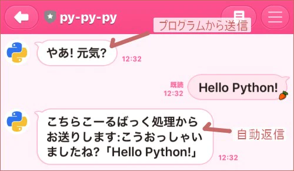
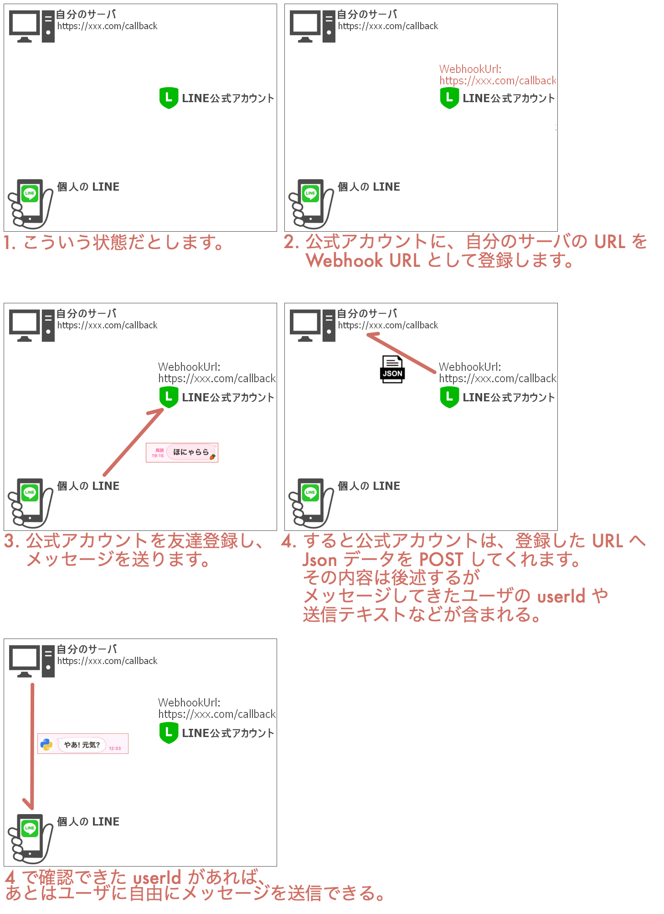

line-messaging-api-py
===

🌲 Python + Flask + LINE Messaging API (line-bot-sdk v3) で作った LINE Bot のサンプルです。



## 概要

- Docker: 対応しています (`Dockerfile`, `compose.yaml`)
- Python: 3.14
- Linter: Ruff
- テスト: pytest
- 主要ライブラリ: line-bot-sdk 3.27.0, Flask 3.1.3, gunicorn 26.2.0
- 依存管理: Pipenv (`Pipfile.lock`)
- CI: GitHub Actions で lint とテストを実行します

## クイックスタート

リポジトリ直下に `.env` を作り、LINE の認証情報を書きます。 `.env` は Git 管理外です。

```
LINE_CHANNEL_SECRET=...
LINE_CHANNEL_ACCESS_TOKEN=...
```

アプリを起動します。

```bash
docker compose up --build app
```

http://localhost:8000/ で確認できます。 LINE の Webhook URL には `https://<公開ホスト>/callback` を設定します。

## lint とテスト

```bash
docker compose run --rm --build dev ruff check .
docker compose run --rm --build dev pytest
```

テストはダミーの認証情報とモックを使います。 LINE へ実際にメッセージを送ることはありません。

## エンドポイント

- `GET /`: 動作確認用のトップページです。
- `POST /callback`: LINE からの Webhook を受け取ります。 `X-Line-Signature` で署名を検証し、不正な署名には 400 を返します。プライバシーのため、 Webhook の本文はログに出しません。
- `GET /register?userId=...`: 登録完了のメッセージをプッシュ送信します。 `userId` がない場合は 400 を返します。

Bot に「とーろく」と送ると、 `/register` へのリンクを返信します。リンクのホストは Webhook を受けたホストで、スキームは https です。

`manual_push_message.py` は環境変数 `USER_ID` のユーザへメッセージを手動でプッシュ送信するスクリプトです。送信に失敗した場合は終了コード 1 で終了します。

```bash
docker compose run --rm --build -e USER_ID=... app python manual_push_message.py
```

## 自分のサーバと LINE 公式アカウントと個人の LINE の関係を示した図



## LINE 公式アカウントの準備

- LINE Developers (https://developers.line.biz/) へログインします。
    - 個人の LINE アカウントでも使えますが、実運用ではビジネスアカウントを想定しています。
- プロバイダ (アプリを提供する組織) を作ります。
- Messaging API チャネルを作ります (LINE に表示させたい名前をつけます)。
- Basic settings > Channel secret の値を `LINE_CHANNEL_SECRET` に設定します。
- Messaging API > Channel access token の値を `LINE_CHANNEL_ACCESS_TOKEN` に設定します。
- アプリをデプロイして動作確認したら、 Messaging API > Webhook settings に Webhook URL を設定します。

## デプロイについて

- 以前は Heroku、その後 Azure App Service へデプロイしていました。
- Azure App Service 向けの workflow (`.github/workflows/dev_line-messaging-api-apple.yml`) は手動実行のみで、現在は使っていません。
